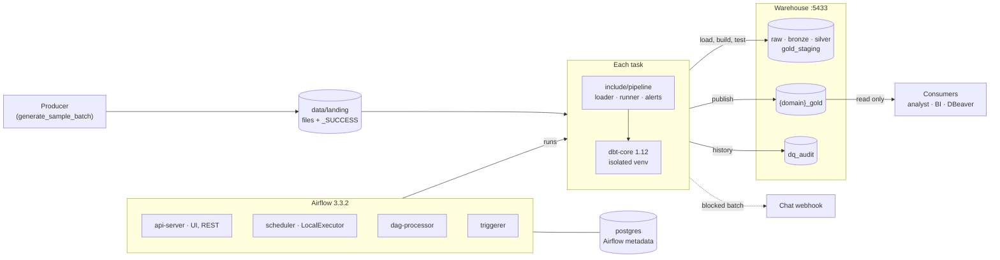
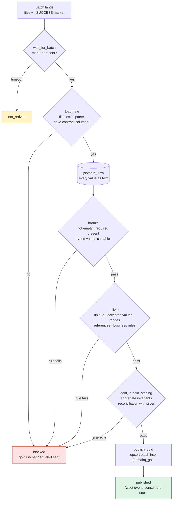
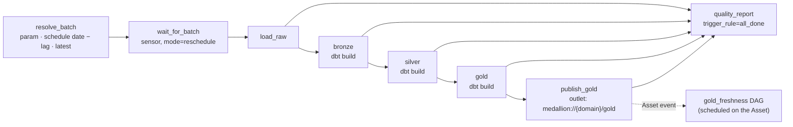
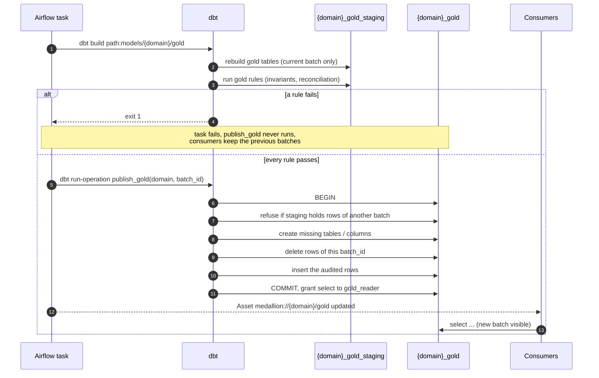
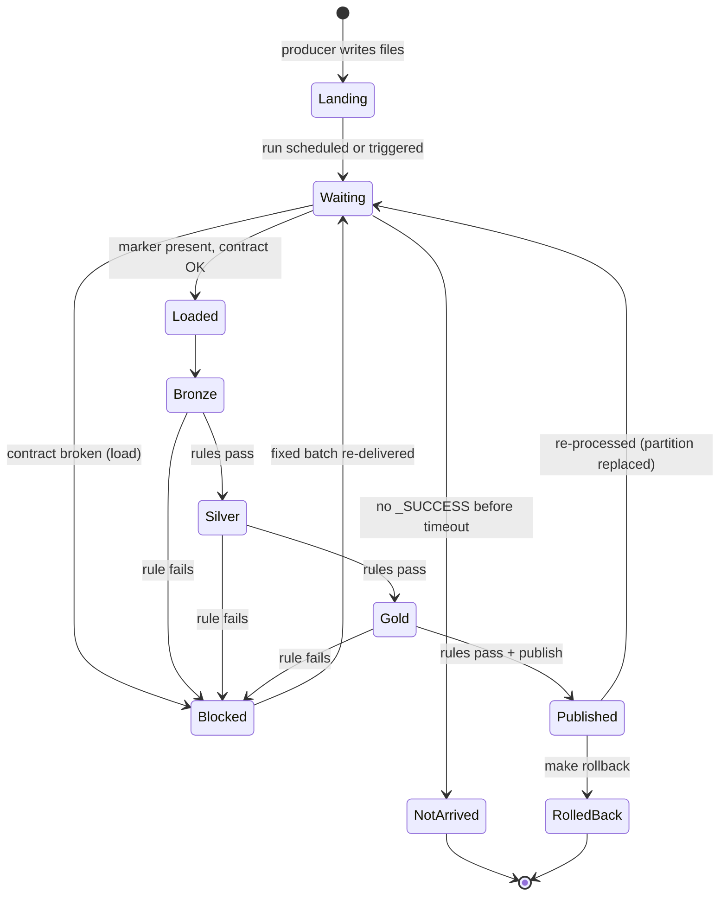
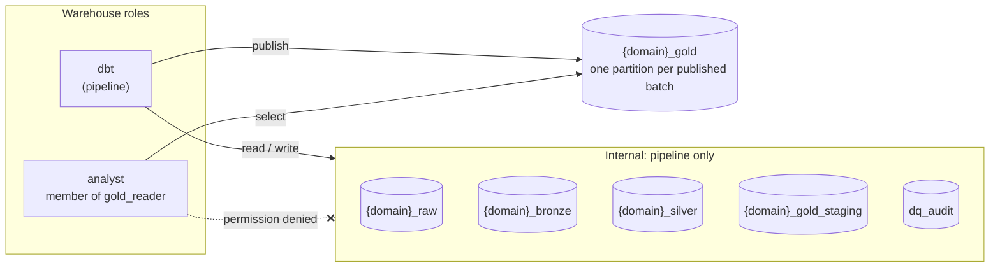
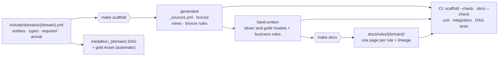

# Architecture

How the pipeline is put together, in seven diagrams. They are [Mermaid](https://mermaid.js.org/)
blocks, which GitHub renders in place. The per-domain lineage diagrams are generated from the dbt
models and live in the [rule catalog](rules/README.md) (one per domain).

1. [System](#1-system) — containers, volumes and who talks to whom
2. [Medallion flow and quality gates](#2-medallion-flow-and-quality-gates)
3. [Airflow DAG](#3-airflow-dag) — the tasks of `medallion_<domain>`
4. [Write-Audit-Publish](#4-write-audit-publish) — how gold is published
5. [Batch lifecycle](#5-batch-lifecycle) — every state a batch can end in
6. [Schemas and access](#6-schemas-and-access) — who can read what
7. [Adding a domain](#7-adding-a-domain) — what is configuration and what is code

## 1. System

All Airflow services share one image (`docker/airflow/Dockerfile`): Airflow plus the pipeline
dependencies, with dbt in its own virtualenv so its dependencies never clash with Airflow's. Each
task also writes `data/reports/{domain}/{batch}/quality_report.json`.

## 2. Medallion flow and quality gates

Every gate is a separate Airflow task. A failing `error`-severity rule fails the task, and
everything after it is skipped, so a bad batch can never reach `<domain>_gold`.

| Gate | Owns | Examples |
|---|---|---|
| load | the **structure** of the files (the contract) | file missing, JSON cut off, column missing |
| bronze | that the batch is **complete and typable** (generated from the contract) | empty file, null ids, `"12,50"` as an amount |
| silver | that each **row** is valid | duplicate ids, unknown currency, discount above the line amount |
| gold | that the **aggregates** make sense | overdraft beyond the credit limit, more than 24 h watched per day |

## 3. Airflow DAG

One `medallion_<domain>` DAG per contract in `include/domains/`, built by
`dags/medallion_pipelines.py`. Runs of a domain are serialized (`max_active_runs=1`).

`quality_report` always runs: it writes the report and the `dq_audit` history, sends the alert,
and fails when the batch was blocked, so a blocked run shows as failed in the UI.

## 4. Write-Audit-Publish

Gold is built and tested where consumers can't see it, and only then copied into the schema
they read, in one transaction.

Because publishing replaces the batch's partition, re-processing a batch is idempotent, and
`make rollback DOMAIN=<d> BATCH=<b>` removes it again.

## 5. Batch lifecycle

The final state of every run is recorded in `dq_audit.pipeline_runs` (`published`, `blocked` or
`not_arrived`), and each rule evaluation in `dq_audit.rule_results`.

## 6. Schemas and access

`publish_gold` re-grants `select` to `gold_reader` on every publish, so new gold tables are
readable right away. Create more consumer logins with `CREATE ROLE x LOGIN IN ROLE gold_reader`.

## 7. Adding a domain

Only the contract and the silver/gold logic are written by hand; the engine, the DAG and the
documentation adapt to the new domain on their own.
