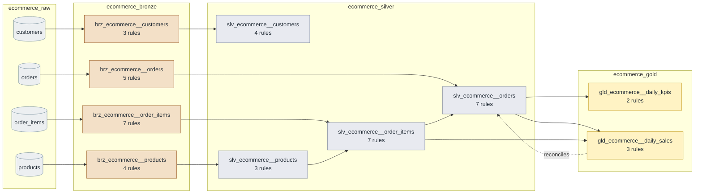

<!-- GENERATED by `python -m pipeline docs` from dbt/models/**/_*.yml — do not edit. -->

# ecommerce rules

Online store — customers, product catalog, orders and order lines.

45 rules: 19 structural (bronze), 26 business (silver and gold). Back to the [catalog](../README.md).

## Lineage

Generated from the `ref()`/`source()` calls in the models; each box shows how many rules guard it. Raw tables hold every batch as text, bronze models are views of the current batch, silver is typed and cleaned, and gold is built in `_gold_staging` and published into `_gold`. Dotted arrows are cross-layer reconciliation rules.

## Silver

| Rule | Model | Checks | Severity | Scenario |
|---|---|---|---|---|
| [`ecommerce_customer_id_unique`](ecommerce_customer_id_unique.md) | `slv_ecommerce__customers` | A customer appears once per snapshot; duplicates would split order history and lifetime value. | error | — |
| [`ecommerce_customer_email_valid`](ecommerce_customer_email_valid.md) | `slv_ecommerce__customers` | Transactional email (receipts, shipping) needs a deliverable address. | error | `invalid_emails` |
| [`ecommerce_customer_country_valid`](ecommerce_customer_country_valid.md) | `slv_ecommerce__customers` | Customers can only register in the markets the store operates in. | error | — |
| [`ecommerce_customer_signup_not_in_future`](ecommerce_customer_signup_not_in_future.md) | `slv_ecommerce__customers` | A signup date in the future signals a timezone or parsing bug upstream. | error | — |
| [`ecommerce_product_sku_unique`](ecommerce_product_sku_unique.md) | `slv_ecommerce__products` | The SKU identifies a product; two catalog rows for one SKU make its price and category ambiguous. | error | — |
| [`ecommerce_product_price_positive`](ecommerce_product_price_positive.md) | `slv_ecommerce__products` | Catalog prices are positive; giveaways are modelled as discounts, not as zero prices. | error | — |
| [`ecommerce_product_category_valid`](ecommerce_product_category_valid.md) | `slv_ecommerce__products` | Every product belongs to a known category, so category reports add up to the total. | error | — |
| [`ecommerce_item_line_unique`](ecommerce_item_line_unique.md) | `slv_ecommerce__order_items` | An order line is identified by order and line number; duplicates would double-count units and revenue. | error | — |
| [`ecommerce_item_discount_valid`](ecommerce_item_discount_valid.md) | `slv_ecommerce__order_items` | A discount can't be negative or larger than the line amount. | error | `excessive_discount` |
| [`ecommerce_item_product_active`](ecommerce_item_product_active.md) | `slv_ecommerce__order_items` | Discontinued products can't be sold. | error | `inactive_product_sold` |
| [`ecommerce_item_order_exists`](ecommerce_item_order_exists.md) | `slv_ecommerce__order_items` | Order lines must belong to an order of the same batch (no orphan lines). | error | — |
| [`ecommerce_item_product_exists`](ecommerce_item_product_exists.md) | `slv_ecommerce__order_items` | Every line sells a product of the catalog; unknown SKUs can't be priced or categorised. | error | `unknown_sku` |
| [`ecommerce_item_quantity_valid`](ecommerce_item_quantity_valid.md) | `slv_ecommerce__order_items` | Between 1 and 1,000 units per line (B2B orders go through another channel). | error | `zero_quantity` |
| [`ecommerce_item_price_positive`](ecommerce_item_price_positive.md) | `slv_ecommerce__order_items` | The price charged per unit must be positive. | error | — |
| [`ecommerce_order_total_matches_items`](ecommerce_order_total_matches_items.md) | `slv_ecommerce__orders` | The charged total equals the sum of its lines (net of discounts), to the cent. | error | `order_total_mismatch` |
| [`ecommerce_order_has_items`](ecommerce_order_has_items.md) | `slv_ecommerce__orders` | An order without lines has nothing to fulfil or charge, which usually means a partial export. | error | `order_without_items` |
| [`ecommerce_order_id_unique`](ecommerce_order_id_unique.md) | `slv_ecommerce__orders` | Same order id with different content means a conflicting replay (exact replays are deduplicated). | error | `duplicate_order_ids` |
| [`ecommerce_order_customer_exists`](ecommerce_order_customer_exists.md) | `slv_ecommerce__orders` | Orders must be placed by a known customer. | error | — |
| [`ecommerce_order_status_valid`](ecommerce_order_status_valid.md) | `slv_ecommerce__orders` | The status must be a step of the order lifecycle: placed, paid, shipped, delivered, cancelled or refunded. | error | `invalid_order_status` |
| [`ecommerce_order_shipping_country_valid`](ecommerce_order_shipping_country_valid.md) | `slv_ecommerce__orders` | Orders only ship to countries the store delivers to. | error | — |
| [`ecommerce_order_not_in_future`](ecommerce_order_not_in_future.md) | `slv_ecommerce__orders` | Orders can't be placed in the future. | error | — |

## Gold

| Rule | Model | Checks | Severity | Scenario |
|---|---|---|---|---|
| [`ecommerce_sales_grain_unique`](ecommerce_sales_grain_unique.md) | `gld_ecommerce__daily_sales` | One row per day and category; duplicates would double-count revenue in reports. | error | — |
| [`ecommerce_sales_net_not_above_gross`](ecommerce_sales_net_not_above_gross.md) | `gld_ecommerce__daily_sales` | Net revenue (after discounts) can never be negative or exceed gross revenue. | error | — |
| [`ecommerce_gold_revenue_reconciles`](ecommerce_gold_revenue_reconciles.md) | `gld_ecommerce__daily_sales` | Gold revenue matches the silver orders it was built from. | error | — |
| [`ecommerce_daily_kpis_not_empty`](ecommerce_daily_kpis_not_empty.md) | `gld_ecommerce__daily_kpis` | A published day must contain at least one valid order; an empty KPI table means everything was filtered out upstream. | error | — |
| [`ecommerce_daily_aov_within_bounds`](ecommerce_daily_aov_within_bounds.md) | `gld_ecommerce__daily_kpis` | A daily average order value above 5,000 has never been a real business day — it signals a pricing/quantity bug or bulk fraud, even if every row looks valid. | error | `bulk_order_anomaly` |

## Bronze (generated from the data contract)

Structural rules derived from `include/domains/ecommerce.yml` by `make scaffold`: every entity is non-empty, required columns are present and typed columns are castable. They don't get their own page.

| Rule | Model | Checks | Scenario |
|---|---|---|---|
| `ecommerce_bronze_customers_not_empty` | `brz_ecommerce__customers` | The model has at least 1 row(s). | `empty_file` |
| `ecommerce_bronze_customers_customer_id_present` | `brz_ecommerce__customers` | `customer_id` is never null. | — |
| `ecommerce_bronze_customers_signup_date_is_date` | `brz_ecommerce__customers` | Every non-null `signup_date` can be cast to `date`. | — |
| `ecommerce_bronze_products_not_empty` | `brz_ecommerce__products` | The model has at least 1 row(s). | — |
| `ecommerce_bronze_products_sku_present` | `brz_ecommerce__products` | `sku` is never null. | — |
| `ecommerce_bronze_products_unit_price_is_numeric` | `brz_ecommerce__products` | Every non-null `unit_price` can be cast to `numeric`. | — |
| `ecommerce_bronze_products_active_is_boolean` | `brz_ecommerce__products` | Every non-null `active` can be cast to `boolean`. | — |
| `ecommerce_bronze_orders_not_empty` | `brz_ecommerce__orders` | The model has at least 1 row(s). | — |
| `ecommerce_bronze_orders_order_id_present` | `brz_ecommerce__orders` | `order_id` is never null. | — |
| `ecommerce_bronze_orders_order_ts_is_timestamptz` | `brz_ecommerce__orders` | Every non-null `order_ts` can be cast to `timestamptz`. | — |
| `ecommerce_bronze_orders_total_amount_present` | `brz_ecommerce__orders` | `total_amount` is never null. | — |
| `ecommerce_bronze_orders_total_amount_is_numeric` | `brz_ecommerce__orders` | Every non-null `total_amount` can be cast to `numeric`. | — |
| `ecommerce_bronze_order_items_not_empty` | `brz_ecommerce__order_items` | The model has at least 1 row(s). | — |
| `ecommerce_bronze_order_items_order_id_present` | `brz_ecommerce__order_items` | `order_id` is never null. | — |
| `ecommerce_bronze_order_items_line_number_is_integer` | `brz_ecommerce__order_items` | Every non-null `line_number` can be cast to `integer`. | — |
| `ecommerce_bronze_order_items_quantity_present` | `brz_ecommerce__order_items` | `quantity` is never null. | — |
| `ecommerce_bronze_order_items_quantity_is_integer` | `brz_ecommerce__order_items` | Every non-null `quantity` can be cast to `integer`. | `fractional_quantity` |
| `ecommerce_bronze_order_items_unit_price_is_numeric` | `brz_ecommerce__order_items` | Every non-null `unit_price` can be cast to `numeric`. | — |
| `ecommerce_bronze_order_items_discount_is_numeric` | `brz_ecommerce__order_items` | Every non-null `discount` can be cast to `numeric`. | — |
