<!-- GENERATED by `python -m pipeline docs` from dbt/models/**/_*.yml — do not edit. -->

# fintech rules

Core banking — customer accounts and their monetary transactions.

34 rules: 11 structural (bronze), 23 business (silver and gold). Back to the [catalog](../README.md).

## Lineage

Generated from the `ref()`/`source()` calls in the models; each box shows how many rules guard it. Raw tables hold every batch as text, bronze models are views of the current batch, silver is typed and cleaned, and gold is built in `_gold_staging` and published into `_gold`. Dotted arrows are cross-layer reconciliation rules.

```mermaid
flowchart LR
  subgraph raw["fintech_raw"]
    raw__accounts[("accounts")]
    raw__transactions[("transactions")]
  end
  subgraph bronze["fintech_bronze"]
    brz_fintech__accounts["brz_fintech__accounts<br/>4 rules"]
    brz_fintech__transactions["brz_fintech__transactions<br/>7 rules"]
  end
  subgraph silver["fintech_silver"]
    slv_fintech__accounts["slv_fintech__accounts<br/>5 rules"]
    slv_fintech__transactions["slv_fintech__transactions<br/>13 rules"]
  end
  subgraph gold["fintech_gold"]
    gld_fintech__account_daily_positions["gld_fintech__account_daily_positions<br/>3 rules"]
    gld_fintech__daily_summary["gld_fintech__daily_summary<br/>2 rules"]
  end
  raw__accounts --> brz_fintech__accounts
  raw__transactions --> brz_fintech__transactions
  brz_fintech__accounts --> slv_fintech__accounts
  brz_fintech__transactions --> slv_fintech__transactions
  slv_fintech__accounts --> slv_fintech__transactions
  slv_fintech__transactions --> gld_fintech__account_daily_positions
  slv_fintech__accounts --> gld_fintech__account_daily_positions
  gld_fintech__account_daily_positions --> gld_fintech__daily_summary
  gld_fintech__account_daily_positions -. reconciles .-> slv_fintech__transactions
  classDef raw fill:#eceff1,stroke:#78909c,color:#1f2933
  classDef bronze fill:#f3e0c7,stroke:#a1662f,color:#1f2933
  classDef silver fill:#e8eaf0,stroke:#8790a3,color:#1f2933
  classDef gold fill:#fff3c4,stroke:#c9a227,color:#1f2933
  class raw__accounts,raw__transactions raw
  class brz_fintech__accounts,brz_fintech__transactions bronze
  class slv_fintech__accounts,slv_fintech__transactions silver
  class gld_fintech__account_daily_positions,gld_fintech__daily_summary gold
```

## Silver

| Rule | Model | Checks | Severity | Scenario |
|---|---|---|---|---|
| [`fintech_account_currency_matches_country`](fintech_account_currency_matches_country.md) | `slv_fintech__accounts` | Accounts are opened in the local currency of their country. | error | — |
| [`fintech_account_id_unique`](fintech_account_id_unique.md) | `slv_fintech__accounts` | An account appears once per snapshot. | error | — |
| [`fintech_account_status_valid`](fintech_account_status_valid.md) | `slv_fintech__accounts` | Accounts are active, frozen or closed: the states the core banking system knows. | error | — |
| [`fintech_credit_limit_within_policy`](fintech_credit_limit_within_policy.md) | `slv_fintech__accounts` | Credit lines go from 0 to 100,000. | error | — |
| [`fintech_account_opened_not_in_future`](fintech_account_opened_not_in_future.md) | `slv_fintech__accounts` | An account can't be opened in the future. | error | — |
| [`fintech_txn_currency_matches_account`](fintech_txn_currency_matches_account.md) | `slv_fintech__transactions` | A transaction is always booked in its account's currency (no implicit FX). | error | `currency_mismatch` |
| [`fintech_card_payment_has_merchant`](fintech_card_payment_has_merchant.md) | `slv_fintech__transactions` | Card payments must carry a merchant category code (MCC) for AML screening. | error | `card_payment_without_merchant` |
| [`fintech_posted_only_on_active_accounts`](fintech_posted_only_on_active_accounts.md) | `slv_fintech__transactions` | Frozen and closed accounts cannot have posted movements. | error | `closed_account_activity` |
| [`fintech_txn_amount_two_decimals`](fintech_txn_amount_two_decimals.md) | `slv_fintech__transactions` | Amounts are expressed in cents; sub-cent precision indicates a broken upstream conversion. | error | — |
| [`fintech_txn_id_unique`](fintech_txn_id_unique.md) | `slv_fintech__transactions` | Same id with different content means a conflicting replay (exact replays are deduplicated). | error | `duplicate_transaction_ids` |
| [`fintech_txn_account_exists`](fintech_txn_account_exists.md) | `slv_fintech__transactions` | Every transaction belongs to a known account; orphan movements can't be reconciled. | error | `orphan_transactions` |
| [`fintech_txn_amount_positive`](fintech_txn_amount_positive.md) | `slv_fintech__transactions` | Amounts are positive; direction comes from txn_type. | error | `negative_amounts` |
| [`fintech_txn_amount_below_single_limit`](fintech_txn_amount_below_single_limit.md) | `slv_fintech__transactions` | Single movements above 10,000 require manual approval and never arrive in this feed. | error | `amount_above_single_limit` |
| [`fintech_txn_high_value_review`](fintech_txn_high_value_review.md) | `slv_fintech__transactions` | Movements above 5,000 are reported for review but do not stop the pipeline. | warn | — |
| [`fintech_txn_currency_supported`](fintech_txn_currency_supported.md) | `slv_fintech__transactions` | Only the ISO 4217 currencies the bank operates in are accepted. | error | `invalid_currency` |
| [`fintech_txn_type_valid`](fintech_txn_type_valid.md) | `slv_fintech__transactions` | The transaction type gives its direction (credit or debit); an unknown type can't be signed. | error | — |
| [`fintech_txn_status_valid`](fintech_txn_status_valid.md) | `slv_fintech__transactions` | Transactions are posted, pending or reversed; only posted ones move balances. | error | — |
| [`fintech_txn_not_in_future`](fintech_txn_not_in_future.md) | `slv_fintech__transactions` | Movements can't be booked in the future (5 minutes of tolerance for clock skew). | error | `future_timestamps` |

## Gold

| Rule | Model | Checks | Severity | Scenario |
|---|---|---|---|---|
| [`fintech_position_grain_unique`](fintech_position_grain_unique.md) | `gld_fintech__account_daily_positions` | One position per account and day; duplicates would double-count balances. | error | — |
| [`fintech_no_overdraft_beyond_credit_limit`](fintech_no_overdraft_beyond_credit_limit.md) | `gld_fintech__account_daily_positions` | No account may end the day with a net outflow larger than its credit limit. | error | `overdraft_beyond_limit` |
| [`fintech_gold_reconciles_with_silver`](fintech_gold_reconciles_with_silver.md) | `gld_fintech__account_daily_positions` | Every posted cent in silver is accounted for in gold. | error | — |
| [`fintech_daily_summary_not_empty`](fintech_daily_summary_not_empty.md) | `gld_fintech__daily_summary` | A published day must contain at least one posted movement. | error | — |
| [`fintech_summary_flows_consistent`](fintech_summary_flows_consistent.md) | `gld_fintech__daily_summary` | Inflows and outflows are non-negative and the net flow equals inflows minus outflows. | error | — |

## Bronze (generated from the data contract)

Structural rules derived from `include/domains/fintech.yml` by `make scaffold`: every entity is non-empty, required columns are present and typed columns are castable. They don't get their own page.

| Rule | Model | Checks | Scenario |
|---|---|---|---|
| `fintech_bronze_accounts_not_empty` | `brz_fintech__accounts` | The model has at least 1 row(s). | — |
| `fintech_bronze_accounts_account_id_present` | `brz_fintech__accounts` | `account_id` is never null. | — |
| `fintech_bronze_accounts_opened_at_is_date` | `brz_fintech__accounts` | Every non-null `opened_at` can be cast to `date`. | — |
| `fintech_bronze_accounts_credit_limit_is_numeric` | `brz_fintech__accounts` | Every non-null `credit_limit` can be cast to `numeric`. | — |
| `fintech_bronze_transactions_not_empty` | `brz_fintech__transactions` | The model has at least 1 row(s). | `empty_file` |
| `fintech_bronze_transactions_transaction_id_present` | `brz_fintech__transactions` | `transaction_id` is never null. | `null_transaction_ids` |
| `fintech_bronze_transactions_account_id_present` | `brz_fintech__transactions` | `account_id` is never null. | — |
| `fintech_bronze_transactions_txn_ts_present` | `brz_fintech__transactions` | `txn_ts` is never null. | — |
| `fintech_bronze_transactions_txn_ts_is_timestamptz` | `brz_fintech__transactions` | Every non-null `txn_ts` can be cast to `timestamptz`. | — |
| `fintech_bronze_transactions_amount_present` | `brz_fintech__transactions` | `amount` is never null. | — |
| `fintech_bronze_transactions_amount_is_numeric` | `brz_fintech__transactions` | Every non-null `amount` can be cast to `numeric`. | `malformed_amounts` |
