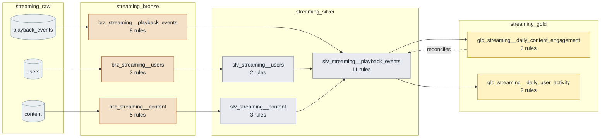

<!-- GENERATED by `python -m pipeline docs` from dbt/models/**/_*.yml — do not edit. -->

# streaming rules

Video/audio streaming — subscribers, content catalog and playback events.

37 rules: 16 structural (bronze), 21 business (silver and gold). Back to the [catalog](../README.md).

## Lineage

Generated from the `ref()`/`source()` calls in the models; each box shows how many rules guard it. Raw tables hold every batch as text, bronze models are views of the current batch, silver is typed and cleaned, and gold is built in `_gold_staging` and published into `_gold`. Dotted arrows are cross-layer reconciliation rules.

## Silver

| Rule | Model | Checks | Severity | Scenario |
|---|---|---|---|---|
| [`streaming_user_id_unique`](streaming_user_id_unique.md) | `slv_streaming__users` | A subscriber appears once per snapshot. | error | — |
| [`streaming_user_plan_valid`](streaming_user_plan_valid.md) | `slv_streaming__users` | Plans are free, basic or premium; entitlements depend on the plan. | error | — |
| [`streaming_content_id_unique`](streaming_content_id_unique.md) | `slv_streaming__content` | A content item appears once in the catalog. | error | — |
| [`streaming_content_type_valid`](streaming_content_type_valid.md) | `slv_streaming__content` | Content is a movie, an episode, a music track or a podcast. | error | — |
| [`streaming_content_duration_valid`](streaming_content_duration_valid.md) | `slv_streaming__content` | Content lasts between 1 second and 6 hours. | error | — |
| [`streaming_event_position_within_duration`](streaming_event_position_within_duration.md) | `slv_streaming__playback_events` | The playhead can't be before the start or past the end of the content. | error | `position_exceeds_duration` |
| [`streaming_event_watch_seconds_valid`](streaming_event_watch_seconds_valid.md) | `slv_streaming__playback_events` | Time watched since the previous event is non-negative and bounded by the content length. | error | `negative_watch_time` |
| [`streaming_completion_requires_90_percent`](streaming_completion_requires_90_percent.md) | `slv_streaming__playback_events` | A play only counts as complete (royalties, recommendations) after 90% of the content. | error | `premature_completion` |
| [`streaming_free_plan_not_on_tv`](streaming_free_plan_not_on_tv.md) | `slv_streaming__playback_events` | Entitlement: TV apps are for paid plans only. | error | `free_user_on_tv` |
| [`streaming_event_after_signup`](streaming_event_after_signup.md) | `slv_streaming__playback_events` | A user can't play content before signing up; this points to wrong user ids or clock issues. | error | `event_before_signup` |
| [`streaming_event_id_unique`](streaming_event_id_unique.md) | `slv_streaming__playback_events` | Same event id with different content means a conflicting replay (exact replays are deduplicated). | error | `duplicate_event_ids` |
| [`streaming_event_user_exists`](streaming_event_user_exists.md) | `slv_streaming__playback_events` | Every playback event belongs to a known subscriber. | error | — |
| [`streaming_event_content_exists`](streaming_event_content_exists.md) | `slv_streaming__playback_events` | Every playback event refers to catalog content (royalties are paid per content item). | error | `unknown_content` |
| [`streaming_event_type_valid`](streaming_event_type_valid.md) | `slv_streaming__playback_events` | Player events are start, pause, resume, stop or complete. | error | — |
| [`streaming_event_device_valid`](streaming_event_device_valid.md) | `slv_streaming__playback_events` | Playback only happens on supported devices: tv, mobile, web or tablet. | error | `invalid_device` |
| [`streaming_event_not_in_future`](streaming_event_not_in_future.md) | `slv_streaming__playback_events` | Events can't happen in the future. | error | — |

## Gold

| Rule | Model | Checks | Severity | Scenario |
|---|---|---|---|---|
| [`streaming_engagement_grain_unique`](streaming_engagement_grain_unique.md) | `gld_streaming__daily_content_engagement` | One row per day and content item. | error | — |
| [`streaming_gold_watch_time_reconciles`](streaming_gold_watch_time_reconciles.md) | `gld_streaming__daily_content_engagement` | Watch hours in gold add up to the watch seconds in silver. | error | — |
| [`streaming_completion_rate_valid`](streaming_completion_rate_valid.md) | `gld_streaming__daily_content_engagement` | The completion rate is completions over plays, so it must be between 0 and 1. | error | — |
| [`streaming_user_activity_grain_unique`](streaming_user_activity_grain_unique.md) | `gld_streaming__daily_user_activity` | One row per user and day. | error | — |
| [`streaming_user_daily_watch_time_possible`](streaming_user_daily_watch_time_possible.md) | `gld_streaming__daily_user_activity` | Nobody watches more than 24 hours in a day — shared or bot accounts, or duplicated events. | error | `impossible_watch_time` |

## Bronze (generated from the data contract)

Structural rules derived from `include/domains/streaming.yml` by `make scaffold`: every entity is non-empty, required columns are present and typed columns are castable. They don't get their own page.

| Rule | Model | Checks | Scenario |
|---|---|---|---|
| `streaming_bronze_users_not_empty` | `brz_streaming__users` | The model has at least 1 row(s). | — |
| `streaming_bronze_users_user_id_present` | `brz_streaming__users` | `user_id` is never null. | — |
| `streaming_bronze_users_signup_date_is_date` | `brz_streaming__users` | Every non-null `signup_date` can be cast to `date`. | — |
| `streaming_bronze_content_not_empty` | `brz_streaming__content` | The model has at least 1 row(s). | `empty_file` |
| `streaming_bronze_content_content_id_present` | `brz_streaming__content` | `content_id` is never null. | — |
| `streaming_bronze_content_duration_seconds_present` | `brz_streaming__content` | `duration_seconds` is never null. | — |
| `streaming_bronze_content_duration_seconds_is_integer` | `brz_streaming__content` | Every non-null `duration_seconds` can be cast to `integer`. | — |
| `streaming_bronze_content_release_date_is_date` | `brz_streaming__content` | Every non-null `release_date` can be cast to `date`. | — |
| `streaming_bronze_playback_events_not_empty` | `brz_streaming__playback_events` | The model has at least 1 row(s). | — |
| `streaming_bronze_playback_events_event_id_present` | `brz_streaming__playback_events` | `event_id` is never null. | — |
| `streaming_bronze_playback_events_user_id_present` | `brz_streaming__playback_events` | `user_id` is never null. | `null_user_ids` |
| `streaming_bronze_playback_events_content_id_present` | `brz_streaming__playback_events` | `content_id` is never null. | — |
| `streaming_bronze_playback_events_event_ts_present` | `brz_streaming__playback_events` | `event_ts` is never null. | — |
| `streaming_bronze_playback_events_event_ts_is_timestamptz` | `brz_streaming__playback_events` | Every non-null `event_ts` can be cast to `timestamptz`. | — |
| `streaming_bronze_playback_events_position_seconds_is_integer` | `brz_streaming__playback_events` | Every non-null `position_seconds` can be cast to `integer`. | — |
| `streaming_bronze_playback_events_watch_seconds_is_integer` | `brz_streaming__playback_events` | Every non-null `watch_seconds` can be cast to `integer`. | `malformed_watch_seconds` |
